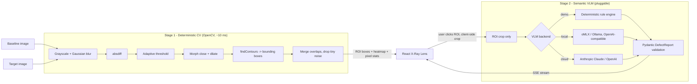

# Multi-Modal Visual QA & Anomaly X-Ray Lens

A hybrid **classical Computer Vision + Vision-Language Model** inspection system.
OpenCV finds *where* something changed between a baseline and a target image in a few
milliseconds; a VLM is then asked *what* changed, but only on the cropped Regions of
Interest (ROIs). Unchanged background pixels are never sent to the model, which cuts
payload size, token cost and inference latency.

A React "X-Ray Lens" lets you drag a split-screen slider over the target image to reveal
the CV diff heatmap, click any flagged region, and watch the structured VLM diagnosis
stream in live over Server-Sent Events.

> Status: under active development. See [`docs/workflow.html`](docs/workflow.html) for the
> live build board and [`docs/CONTRACTS.md`](docs/CONTRACTS.md) for interface contracts.

## Architecture: the two-stage funnel



| Layer | Tech |
|---|---|
| CV preprocessing | OpenCV, NumPy |
| API | FastAPI, Pydantic v2, pydantic-settings, SSE streaming, structured JSON logging |
| VLM | OpenAI-compatible local server (oMLX / Ollama), Anthropic or OpenAI cloud, demo fallback |
| Frontend | Vite, React 18, TypeScript (strict), Canvas |
| Quality | pytest (TDD), ruff, mypy, Vitest, GitHub Actions CI |
| Delivery | Docker, Docker Compose |

## VLM modes and cost model

| Mode | Cost | Use |
|---|---|---|
| `demo` (default) | Free, no keys, instant | Public website widget, CI, offline demos |
| `local` | Free, runs on your machine | oMLX (Apple Silicon) or Ollama with a small vision model, e.g. Qwen2.5-VL |
| `cloud` | Owner pays, never the visitor | Server-side key, guarded by per-IP rate limit, daily request cap and a response cache |

## Quick start

Full setup instructions (backend, frontend, Docker) are finalized when the build completes.

```bash
cd backend && uv venv && uv pip install -r requirements-dev.txt
```

## Interview talking points

1. **Do the cheap, deterministic thing first.** Pixel differencing is O(pixels) and runs in
   milliseconds on a CPU. A VLM call costs hundreds of milliseconds to seconds and is billed
   per image token. Let the cheap stage decide *where to look*.
2. **Tokens scale with pixels.** Image token cost is roughly proportional to area
   (`w*h/750` for Claude). Sending a 120x90 crop instead of a 960x640 frame is a ~98% reduction
   for that call, and the benchmark script measures this across the sample set.
3. **Better answers, not just cheaper ones.** A crop removes distractors, so the model attends
   to the defect instead of describing the whole scene. Smaller context also means less room
   for hallucinated "findings" in unchanged areas.
4. **Deterministic localization, probabilistic interpretation.** Bounding boxes come from
   reproducible CV, so they are testable with unit tests; the VLM only adds semantics, and its
   output is forced through a strict Pydantic schema.
5. **Pluggable, cost-safe backends.** The same interface serves a free rule engine, a local
   model and a cloud model, with caching and rate limits on the paid path.
