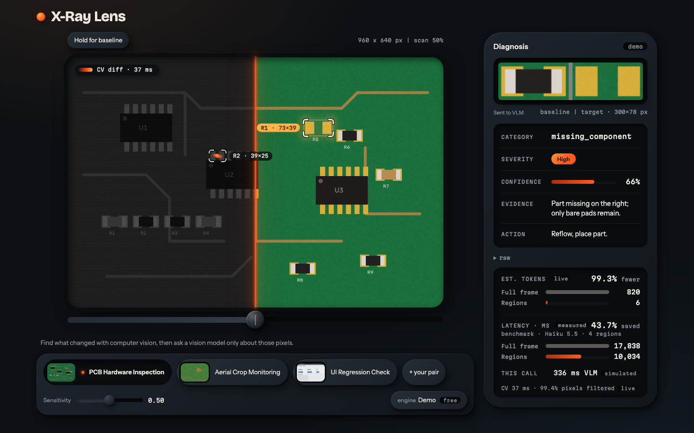
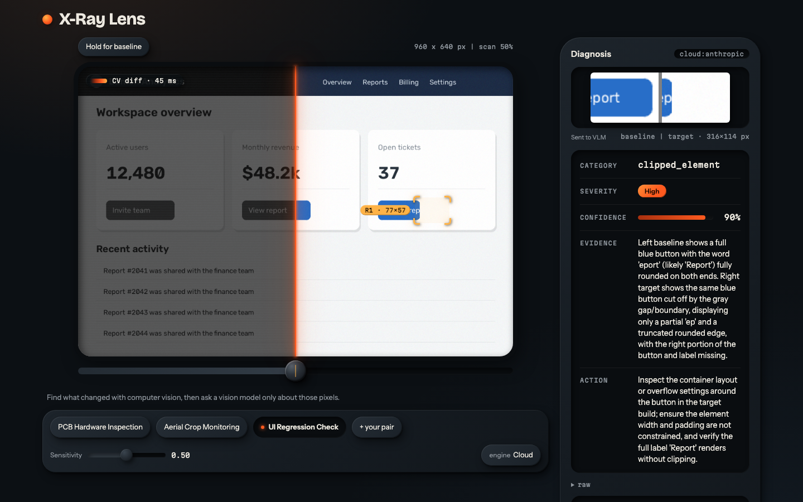
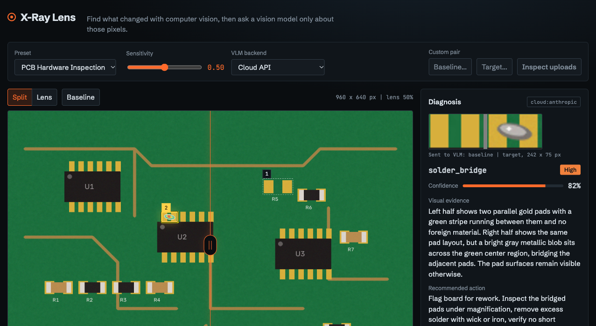
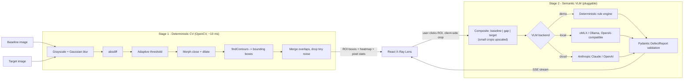

# Multi-Modal Visual QA & Anomaly X-Ray Lens

A hybrid **classical Computer Vision + Vision-Language Model** inspection system.
OpenCV finds *where* something changed between a baseline and a target image in a few
milliseconds; a VLM is then asked *what* changed, but only on the cropped Regions of
Interest (ROIs). Unchanged background pixels are never sent to the model, which cuts
payload size, token cost and inference latency.

A React "X-Ray Lens" shows the result. A split lens on a knob and rail slides over the target
image to reveal the CV diff as a machine-vision scan, and you can hold a button to peek at the
baseline. Flagged regions lock on with corner brackets. Click one and its crop flies into a
readout that fills in field by field as the structured diagnosis streams over Server-Sent
Events. A full frame vs regions comparison shows the token and latency savings, each tagged
live, measured or simulated.



*The X-Ray Lens UI in demo mode (free, simulated diagnosis; latency bars are the measured Haiku 5.5 benchmark).*



*Live run: the same UI with the Cloud engine (Claude Haiku 5.5). The diagnosis, the 1,739 ms call time and the token numbers are tagged `live`.*



*Live-model example: PCB solder bridge diagnosed by Claude Haiku 5.5 from a 242x75 px composite (a real run, not demo mode).*

Project process: built by a manager agent with worker agents, TDD, one PR per feature. See
[`docs/workflow.html`](docs/workflow.html) (build board) and [`docs/CONTRACTS.md`](docs/CONTRACTS.md)
(interface contracts). The UI redesign is described in
[`docs/redesign/PROPOSAL.md`](docs/redesign/PROPOSAL.md), with evidence per step under `docs/redesign/`.

## Architecture: the two-stage funnel



| Layer | Tech |
|---|---|
| CV preprocessing | OpenCV, NumPy |
| API | FastAPI, Pydantic v2, pydantic-settings, SSE streaming, structured JSON logging |
| VLM | OpenAI-compatible local server (oMLX / Ollama), Anthropic or OpenAI cloud, demo fallback |
| Frontend | Vite, React 18, TypeScript (strict), Canvas |
| Quality | pytest (TDD), ruff, mypy, Vitest, GitHub Actions CI |
| Delivery | Docker, Docker Compose |

## VLM modes

| Mode | Cost | Use |
|---|---|---|
| `demo` (default) | Free, no keys, instant | Public website widget, CI, offline demos |
| `local` | Free, runs on your machine | oMLX (Apple Silicon) or Ollama with a small vision model, e.g. Qwen2.5-VL |
| `cloud` | Owner pays, never the visitor | Server-side key, guarded by per-IP rate limit, daily request cap and a response cache |

## Abuse protection

- nginx edge limits per client IP (`frontend/nginx.conf`): 10 req/min (burst 5) on `/api/inspect` and `/api/analyze-roi`, 60 req/min (burst 20) on the rest of `/api/`, 10 concurrent connections; excess gets HTTP 429.
- Backend, cloud mode only: per-IP rate limit, a global daily request cap and a response cache.
- The backend trusts `X-Forwarded-For` only from configured proxies (`FORWARDED_ALLOW_IPS`): `127.0.0.1` by default, `*` inside Docker Compose, where only nginx can reach the backend.
- For public deploys, set a monthly spend limit in the Anthropic console and put Cloudflare (or another CDN/WAF) in front; configure nginx `real_ip_header` so limits apply to the real client IP.

## Quick start

### Option A: Docker

```bash
docker compose up --build
```

Open http://localhost:3000. If port 3000 is busy: `FRONTEND_PORT=3999 docker compose up --build`.
The backend is not published to the host; the nginx frontend proxies `/api` to it. Without any
configuration the app runs in `demo` mode (free, no keys).

### Option B: Local development

Backend (port 8080):

```bash
cd backend
uv venv && uv pip install -r requirements-dev.txt
source .venv/bin/activate
uvicorn app.main:app --reload --port 8080
```

Frontend (port 5173, Vite proxies `/api` to `localhost:8080`):

```bash
cd frontend
npm install
npm run dev
```

`make setup`, `make dev-backend` and `make dev-frontend` wrap similar steps (pip instead of uv).

### Option C: Configuration, tests, benchmark

```bash
cp backend/.env.example backend/.env   # never commit the real .env
```

Set `VLM_MODE` in `backend/.env`:

| `VLM_MODE` | What you need |
|---|---|
| `demo` (default) | Nothing. Deterministic rule engine. |
| `local` | An OpenAI-compatible server. oMLX at `http://localhost:8000/v1` with model `mlx-community--Qwen2.5-VL-7B-Instruct-4bit` (set `LOCAL_VLM_MODEL`); Ollama also works (`http://localhost:11434/v1`). |
| `cloud` | `ANTHROPIC_API_KEY` (default model `claude-haiku-5-5`). |

For cloud mode, create a dedicated Anthropic workspace with its own spend limit and take the
key from that workspace.

Tests and linters (from the repo root):

```bash
(cd backend && python -m pytest -q && ruff check . && mypy app)
(cd frontend && npm test && npm run lint && npm run typecheck)
```

Benchmark (from `backend/`, with the virtualenv active):

```bash
cd backend
PYTHONPATH=. python -m app.benchmark --backend demo   # or local | cloud
```

## How the VLM sees a region

The frontend sends the model one composite image: **baseline | 8 px gray gap | target**, both
cropped to the same ROI. Crops whose short side is under 75 px are upscaled (up to 4x); the gap
is never scaled.

- A target-only crop cannot show what is missing. Side by side, the model can compare.
- Tiny crops starve the model of pixels, so it guesses. Upscaling gives it enough detail.

## Benchmark results

Three sample presets, four regions in total (the `pcb` preset has 2 regions, so it makes 2 ROI
calls). Full frame means one call per preset with the whole image.

| | Local oMLX, Qwen2.5-VL-7B 4-bit (Apple Silicon) | Cloud, Claude Haiku 5.5 |
|---|---|---|
| Bytes, full vs ROI | 2,899,093 vs 126,889 (95.6% saved) | 2,899,031 vs 124,107 (95.7% saved) |
| Image tokens, full vs ROI | 2,460 vs 121 (95.1% saved) | 2,460 vs 117 (95.2% saved) |
| Total time, full vs ROI | 14,353 ms vs 14,046 ms (2.1% saved) | 17,838 ms vs 10,034 ms (43.7% saved) |
| Per call, full vs ROI | ~4.8 s vs ~3.5 s | ~4.8-6.7 s vs ~2.2-2.8 s |

Local latency is dominated by fixed per-call overhead (prompt prefill, model generation), not
image size, so cropping barely helps time locally. In the cloud it helps a lot.

These runs were taken before the small-crop upscale; the upscaled U2 composite is about 26
tokens, which is negligible. Demo mode latency is simulated and labelled as such.

### Model comparison, region by region

| Region | Qwen2.5-VL-7B (local) | Claude Haiku 5.5 |
|---|---|---|
| PCB R5, missing component | Correct | Correct (0.92) |
| PCB U2, solder bridge (39x25 px) | Wrong (`missing_component`), even with 3x/5x upscale, prompt rewording and category reordering | Without upscale: "no clear defect" at 0.30 (honest low confidence). With 3x upscale: `solder_bridge` (live UI run: High, 82%) |
| Aerial, irrigation stress | Correct | Correct |
| UI, clipped button | Correct | Correct |
| **Total** | **3/4** | **4/4 with upscale** |

#### Live UI check (2026-11-18)

Four regions run through the UI with the Cloud engine (Claude Haiku 5.5):

| Region | Category | Severity | Confidence | Time |
|---|---|---|---|---|
| PCB R1 | missing_component | High | 93% | 2,211 ms |
| PCB R2 (solder bridge, 242x75 composite) | solder_bridge | High | 80% | 2,027 ms |
| Aerial R1 | irrigation_stress | Medium | 82% | 2,591 ms |
| UI R1 | clipped_element | High | 90% | 1,739 ms |

All 4 were correct. Total cost was well under $0.01.

The 7B local model is fine for a free demo. Production QA needs a stronger model: Haiku, or a
larger local model such as Qwen2.5-VL-32B.

## Cost model (cloud, Claude Haiku 5.5)

List price as of Nov 2026: $0.10 per 1M input tokens, $0.50 per 1M output tokens. Check
Anthropic's pricing page, prices can change.

- One analysis is about 300 prompt tokens + 15-90 image tokens + 150-600 output tokens
  (including reasoning; effort is set to low), roughly $0.00015-0.00035.
- 100 users x 10 regions is about $0.15-0.35.
- The daily cap of 200 calls bounds spend at about $0.07/day, about $2/month worst case.
- The response cache makes repeated analyses free.

## Interview talking points

1. **Do the cheap, deterministic thing first.** Pixel differencing is O(pixels) and runs in
   milliseconds on a CPU. A VLM call costs hundreds of milliseconds to seconds and is billed
   per image token. Let the cheap stage decide *where to look*.
2. **Tokens scale with pixels.** Image token cost is roughly proportional to area
   (`w*h/750` for Claude). Sending a 120x90 crop instead of a 960x640 frame is a ~98% reduction
   for that call. Measured over the three sample presets: about 95% fewer image bytes and tokens
   (2,460 tokens full frame vs 117-121 ROI), see [Benchmark results](#benchmark-results).
3. **Better answers, not just cheaper ones.** A crop removes distractors, so the model attends
   to the defect instead of describing the whole scene. The flip side: a crop that is too small
   starves the model, so tiny crops are upscaled and shown next to the baseline (a 39x25 px solder
   bridge went from wrong to right with Haiku once upscaled). Smaller context also means less room
   for hallucinated "findings" in unchanged areas.
4. **Deterministic localization, probabilistic interpretation.** Bounding boxes come from
   reproducible CV, so they are testable with unit tests; the VLM only adds semantics, and its
   output is forced through a strict Pydantic schema.
5. **Pluggable, cost-safe backends.** The same interface serves a free rule engine, a local
   model and a cloud model, with caching and rate limits on the paid path.
